# agy-neo

Binary patcher and local harness for Google's Antigravity CLI (`agy v1.5.17`, macOS Apple silicon).
It patches `~/.local/bin/agy` from a verified stock backup to remove Cortex's 256K/64K context
clamps, enable and unify `agy`'s built-in prompt-cache keepalive across OAuth and local gateways,
trim stock system-prompt bloat, and clean up the terminal UI.

<p align="center">
  
</p>

## What it changes

**Context windows and gateway routing**
- Configures `agy`'s native `AGY_CLI_AUTO_COMPACT_OVERRIDE` via `AUTO_COMPACT_WINDOW=512K` in
  `agy-neo.conf` (exported by `hub-wrapper.sh` and parsed live by `statusline.sh`, accepting token
  counts, `K`/`M` shorthand, or percentages across all models including Orchestrator), and removes
  Cortex's remaining 256K checkpointer ceiling and 64K `USER_INPUT` step clamp (`#7a`–`#7d`).
- Routes local gateway sessions (`agy --settings '{"modelProvider":"gemini"}'`, `AGY_LOCAL_GATEWAY=on`,
  and VS Code `--hub`) through `modelapiccpa` via `AGY_LLM_GATEWAY_*`, keeping `sessionId` account
  affinity intact, listing `Gemini 4 Neon` (`Low`–`XHigh`), Carbon, Argon, and Hydrogen with native
  effort gauges and `thinkingLevel`, and assigning background tiers (`flash_lite`, `flash`, `pro`)
  to Hydrogen High, Neon XHigh, and Carbon High.

**Built-in prompt-cache keepalive and status line**
- Activates `agy`'s native `modelapiccpa.(*keepAlives)` timer directly inside the Go binary for both
  Google OAuth and local gateway sessions—no external proxy or re-request wrapper script.
- Fires an in-process `maxOutputTokens: 1` touch after `4m30s` of idle time with the full prompt
  prefix preserved (bypassing stock `trimLastBlock`), skips subagent turns, and stops automatically
  after `CACHE_MAX_TOUCHES` (default `4` in `agy-neo.conf`) or on an upstream cache miss.
- Publishes live keepalive state, touch count, and refresh timestamps into `StatusLineData` JSON
  in-process, and triggers a `15s` idle tick so `statusline.sh` is a pure display consumer showing
  model, throughput, context usage, cache countdown, active Git worktree, and spend.

**Transcript, thoughts, and running line**
- Streams thoughts live in the transcript and folds finished thoughts into `∴ Thought for 7s (<title>)`
  under `/thinking off`, or grows them in place as a full block with token counts under `/thinking on`
  or `ctrl+o`—orthogonal to `verbosity` (`low` / `medium` / `high`). Thoughts stay separate from tool
  groups.
- Marks running tool calls and pending checklist steps with `⊹`, completed tool calls and active
  checklist steps with `⋆`, and active Swarm status rows with `✦`; quiets the prompt/tool/thought
  palette, stabilizes streaming code-comment contrast, and updates both the prompt bar and fenced
  code / preview syntax highlighting (`native`/`swapoff` dark ↔ `github` light, with separate dark
  and light markdown cache namespaces) live when the terminal switches between light and dark mode.
- Replaces the stock spinner row with a breathing Gemini star, a blue-to-lavender running light over
  one verb per turn, and an effort/elapsed aside (`(12s ⋅ thinking with high effort)`), with height
  accounting so the status line stays on screen.

**Tool latency and system prompt**
- Disables synchronous pre-tool LLM safety monitors so tool calls run without an extra model
  round-trip in front of them.
- Replaces or drops verbose stock system-prompt sections (`18.1K → 9.6K` chars in
  [`templates/v1.5.17/`](./templates/v1.5.17/README.md)), verified by SHA-256 against Google's
  stock templates before patching.

## Safety model

- **Clean backup rebuilds.** Every `--apply` starts from `~/.local/bin/agy.v1.5.17.orig` and
  re-signs the binary; `--revert` restores the unpatched binary.
- **Symbol and anchor resolution.** Patch sites resolve from Go's `__lrodata_gopcln` symbol table,
  surrounding instruction patterns, and dynamic stack/struct offsets rather than fixed addresses.
- **Reviewed instruction shapes.** `site_shapes.json` stores the normalized stock instruction shape
  for every code site; `--apply` refuses unreviewed upstream changes until inspected and recorded
  with `--accept-shapes`.
- **Valid Go stack maps.** Patched code never introduces function calls at unmapped PCs.
- **Loopback rehearsal.** `probe_agy.py rehearse` exercises wire requests and PTY screens on
  isolated copies before touching `~/.local/bin/agy`.

## Setup (`agy v1.5.17`)

Requires macOS on Apple silicon, Python 3.12+, `jq`, and Xcode Command Line Tools (`codesign`).

1. Place stock `agy v1.5.17` at `~/.local/bin/agy`.
2. Apply the binary patch and install `~/.gemini/bin/agy` (`hub-wrapper.sh`), `statusline.sh`,
   `title.sh`, and `agy-neo.conf` (defaults to `AUTO_COMPACT_WINDOW=512K`):
   ```sh
   mkdir -p ~/.gemini/bin
   python3 patch_agy.py --apply
   ```
   To change the auto-compaction threshold later (no re-patch needed), edit `AUTO_COMPACT_WINDOW`
   in `~/.gemini/antigravity-cli/agy-neo.conf`, run `python3 patch_agy.py --status --set-window 800K`,
   or pass `AGY_CLI_AUTO_COMPACT_OVERRIDE=80% agy` for a single session.
3. Add to `~/.zshrc` and open a new shell:
   ```sh
   export AGY_CLI_DISABLE_AUTO_UPDATE=true   # must be the exact string `true`
   alias agy="$HOME/.gemini/bin/agy"         # loads agy-neo.conf and gateway routing
   ```
4. Enable the status line (and optional OSC 2 terminal title) in `~/.gemini/antigravity-cli/settings.json`:
   ```json
   "statusLine": {"type": "command", "command": "~/.gemini/antigravity-cli/statusline.sh", "enabled": true},
   "title": {"type": "command", "command": "~/.gemini/antigravity-cli/title.sh", "enabled": true}
   ```
5. Optional local gateway (CLIProxyAPI on `127.0.0.1:5233`):
   ```sh
   cp agy-gateway.env.example ~/.gemini/agy-gateway.env && chmod 600 ~/.gemini/agy-gateway.env
   ```
   Set `CPA_API_KEY` in `~/.gemini/agy-gateway.env`. Plain `agy` uses Google OAuth;
   `agy --settings '{"modelProvider":"gemini"}'` (or `AGY_LOCAL_GATEWAY=on`, or VS Code `--hub`)
   routes through the local gateway via `modelapiccpa`.
6. Verify with `python3 patch_agy.py --status -v`: `~/.local/bin/agy` reports `patched` (`156`
   sites) and `~/.gemini/bin/agy` reports `wrapper`.

## Upgrading to a new `agy` release

Background auto-update stays disabled so upstream releases never overwrite the patched binary
unseen. Rehearse a new release on copies first:

```sh
python3 probe_agy.py rehearse
```

Once rehearsal passes (and any shifted site shapes or template changes are reviewed):

```sh
env -u AGY_CLI_DISABLE_AUTO_UPDATE agy update
python3 patch_agy.py --apply
python3 patch_agy.py --status -v
```

If a site fails to resolve, check
[`context-window-patch.md` §5](./references/context-window-patch.md#5-authoring-pitfalls) before
editing `patch_agy.py`. Remove the previous `.orig` backup once the new release is verified.

## Repository layout

| Path | Role |
| :--- | :--- |
| [`patch_agy.py`](./patch_agy.py) | Binary and prompt-template patcher (`--status`, `--apply`, `--revert`, `--accept-shapes`, `--set-window`). |
| [`probe_agy.py`](./probe_agy.py) | Loopback verification (`wire`, `tui`, `sites`, and end-to-end `rehearse`). |
| [`check_agy_update.py`](./check_agy_update.py) | Queries the official manifest for newer releases; `--fetch` downloads and verifies SHA-512. |
| [`inspect_agy.py`](./inspect_agy.py) | Parses Go `pclntab` symbols, `BL` call targets, string literals, and TUI palette/style tables. |
| [`capture_prompt.py`](./capture_prompt.py), [`prompt_templates.py`](./prompt_templates.py) | Captures rendered prompts and tool schemas; inspects and validates embedded `.tmpl` slots. |
| [`templates/v1.5.17/`](./templates/v1.5.17/README.md) | System-prompt overrides and stock SHA-256 digests for `agy v1.5.17`. |
| [`hub-wrapper.sh`](./hub-wrapper.sh) | Installed at `~/.gemini/bin/agy`: exports `agy-neo.conf` keepalive and auto-compact policy and routes gateway/`--hub` sessions. |
| [`agy-neo.conf`](./agy-neo.conf), [`statusline.sh`](./statusline.sh), [`title.sh`](./title.sh) | Policy file (`~/.gemini/antigravity-cli/agy-neo.conf`), status line (`CacheKeepalive` & `AUTO_COMPACT_WINDOW`), and OSC 2 terminal title script (`<glyph> <dir> ⋅ <title>`). |
| [`consult_gemini_mcp.py`](./consult_gemini_mcp.py) | MCP server delegating queries to a shared `agy acp` process. |
| [`assets/`](./assets) | Hero SVG rendered from the patch's own spinner frames and palette. |
| [`diagnostics/`](./diagnostics) | Standalone upstream protocol and cache-TTL probes kept for reference. |

## Technical references

- [`context-window-patch.md`](./references/context-window-patch.md) — binary patch specification, keepalive telemetry layout, and authoring pitfalls.
- [`pending-line.md`](./references/pending-line.md) — running-line spinner, light sweep, verb selection, and viewport height accounting.
- [`tui-styles-and-palette.md`](./references/tui-styles-and-palette.md) — palette slots, `Styles` offsets, and TUI rendering internals.
- [`subagents-and-models.md`](./references/subagents-and-models.md) — subagent definitions, background model tiers, and settings precedence.
- [`hub-and-vscode-extension.md`](./references/hub-and-vscode-extension.md) — `--hub` architecture, VS Code extension integration, and gateway routing.
- [`system-prompt.md`](./references/system-prompt.md) — prompt assembly order and template slot mechanics.

## License

[MIT](./LICENSE). Not affiliated with Google.
