# agy-neo

An opinionated patcher for Google's Antigravity CLI (`agy`) on macOS, Apple silicon. It rewrites
the `agy` binary in place to open its larger context windows, route its models through a gateway, and
redraw its terminal UI. It also ships the tools that keep those patches honest across releases.

<p align="center">
  
</p>

## What changes

**Context and models**
- The `/model` context selector offers `256K`, `512K` and `900K` on Gemini 4, and the 256K
  checkpointer ceiling and 64K step clamp come off.
- Under a local gateway, the picker lists Gemini 4 Carbon, Argon and Hydrogen with their effort
  gauges, and the background tiers (titles, safety checks, subagents) run on Hydrogen and Carbon.

**The line that shows a turn is running**
- A Gemini star grows from a point and breathes, and a blue-to-lavender light swings across one verb
  of the night sky per turn.
- An aside in gray tells the time and the state: `(12s ⋅ thinking with high effort)`. The effort comes
  from the model's own label; past a minute the thought reads `deep in thought`.
- A blank row sets the line apart from the conversation, and the layout counts it, so the status line
  never leaves the screen.

**Thoughts and the transcript**
- A thought shows in the conversation as it runs and folds into `∴ Thought for 7s (<title>)` when it
  ends. Under `high` verbosity, it streams as a growing block instead.
- Thoughts stay out of tool groups. Tool calls carry star marks: `⋆` done, `⊹` running.
- Tool names, arguments, the user's prompt and the thought text get a quieter typography and palette.
  The prompt bar follows the terminal between light and dark without a restart.
- A code comment above a streaming answer keeps one gray instead of flickering between two.

**Around the session**
- A status line script, refreshed while idle, shows the model, context, cache and spend.
- A cache relay keeps an idle session's prompt cache warm.
- The synchronous pre-tool LLM safety monitors are off, so tool calls start without a model call
  in front of them.
- Each release's system prompt can be rewritten section by section in `templates/v<ver>/`.

## How it stays safe

- **Rebuilt from a clean backup.** Every `--apply` starts from `agy.v<ver>.orig`, so the binary is
  always the backup plus the current patches, and `--revert` restores it.
- **Found, not hard-coded.** Each patch site is found by its function in Go's symbol table and by the
  instructions around it, so most sites follow `agy` from release to release.
- **Shapes reviewed.** A clean binary whose code at any site has a shape nobody has reviewed is
  refused until `--accept-shapes` records it (`site_shapes.json`).
- **No new calls.** Added code never adds a function call, which keeps the Go runtime's stack maps
  valid.
- **Probed before use.** `probe_agy.py` drives a patched copy in a pseudo-terminal against a loopback
  endpoint, so a change is seen working before it is installed.

## Setup

Needs macOS on Apple silicon, Python 3.12+, `jq` (for the status line) and the Xcode command line
tools (`codesign`). Clone the repo anywhere; the commands run from its root. The tools find the repo
from where they are, and only the installed files keep fixed places: the binary at
`~/.local/bin/agy`, the wrapper at `~/.gemini/bin/agy`.

1. Install a stock `agy` at `~/.local/bin/agy` whose version has a `templates/v<ver>/` here.
2. Patch it, and install the wrapper and the status line:
   ```sh
   mkdir -p ~/.gemini/bin
   python3 patch_agy.py --apply --set-window 512K
   ```
3. Add to `~/.zshrc`, then open a new shell:
   ```sh
   export AGY_CLI_DISABLE_AUTO_UPDATE=true   # the updater accepts only the exact string `true`
   alias agy="$HOME/.gemini/bin/agy"         # through the wrapper: cache relay, gateway routing
   ```
   Without the export, a background update replaces the patched binary. Without the alias, `agy`
   runs patched but without the cache relay or the gateway settings.
4. Turn the status line on in `~/.gemini/antigravity-cli/settings.json`:
   ```json
   "statusLine": {"type": "command", "command": "~/.gemini/antigravity-cli/statusline.sh", "enabled": true}
   ```
5. For a local gateway (CLIProxyAPI on `127.0.0.1:5233`), copy the settings and set `CPA_API_KEY`:
   ```sh
   cp agy-gateway.env.example ~/.gemini/agy-gateway.env && chmod 600 ~/.gemini/agy-gateway.env
   ```
   The backend follows the `modelProvider` setting, not the environment. `agy` uses Google OAuth;
   `agy --settings '{"modelProvider":"gemini"}'` uses the gateway, with the key and URL from
   `agy-gateway.env`.
6. Check: `python3 patch_agy.py --status -v` reads `patched` for the binary and `wrapper` for
   `~/.gemini/bin/agy`.

## Updating `agy`

Auto-update stays off, so a release never replaces the patched binary unseen. To take one, first
rehearse it: `python3 probe_agy.py rehearse` fetches and verifies the release, patches and probes
copies, and leaves the installed binary alone. Once its table reads `ok`:

```sh
env -u AGY_CLI_DISABLE_AUTO_UPDATE agy update
python3 patch_agy.py --apply        # backs up the new clean binary, then patches it
python3 patch_agy.py --status -v    # every site must read `patched`
```

If a site fails to resolve, read
[`context-window-patch.md` §5](./references/context-window-patch.md#5-authoring-pitfalls) before
changing it. Delete the previous version's `.orig` once the new one is verified.

## The repository

| Path | What it is |
| :--- | :--- |
| [`patch_agy.py`](./patch_agy.py) | The patcher: `--status`, `--apply`, `--revert`, `--accept-shapes`, `--set-window`. |
| [`probe_agy.py`](./probe_agy.py) | Proves a binary as it is used: `tui` drives it in a pty, `wire` shows what each model sends, `rehearse` runs a whole upgrade on copies. |
| [`check_agy_update.py`](./check_agy_update.py) | Says whether a newer release exists; `--fetch` downloads and verifies it. |
| [`inspect_agy.py`](./inspect_agy.py) | Finds Go symbols, call graphs and string literals in the binary; dumps the TUI's palette and styles. |
| [`capture_prompt.py`](./capture_prompt.py), [`prompt_templates.py`](./prompt_templates.py) | Record the exact prompt `agy` sends, and check and edit its templates against the binary. |
| [`templates/v<ver>/`](./templates/v1.5.8/README.md) | The templates we change in one release, each with its reason and the digest of Google's original. Google's own text stays local (`stock/`, git-ignored). |
| [`hub-wrapper.sh`](./hub-wrapper.sh) | The wrapper installed as `~/.gemini/bin/agy`: gateway routing, the VS Code `--hub`, the cache relay. |
| [`cache_relay.py`](./cache_relay.py), [`statusline.sh`](./statusline.sh) | The prompt cache keepalive, and the status line that drives and shows it. |
| [`consult_gemini_mcp.py`](./consult_gemini_mcp.py) | An MCP server that lets Claude Code consult Gemini through one shared `agy acp` process. |
| [`assets/`](./assets) | The README's picture, drawn by `make_hero.py` from the patch's own frames and colors. |
| [`diagnostics/`](./diagnostics) | Investigations and probes kept for reference: upstream 400s, cache lifetime. |

## References

Read these when the work calls for them; each one explains its patches site by site.

- [`context-window-patch.md`](./references/context-window-patch.md): every binary site, why it exists, and the pitfalls of writing one.
- [`pending-line.md`](./references/pending-line.md): the running line, its star, light, verbs and aside, and how the layout counts it.
- [`tui-styles-and-palette.md`](./references/tui-styles-and-palette.md): the TUI's palette and style tables, and what draws with each.
- [`subagents-and-models.md`](./references/subagents-and-models.md): subagents, model tiers, and which settings source wins.
- [`hub-and-vscode-extension.md`](./references/hub-and-vscode-extension.md): the CLI, `--hub` and the VS Code extension, and routing them through a gateway.
- [`system-prompt.md`](./references/system-prompt.md): how the system prompt is assembled, and what each control surface can change.

## License

[MIT](./LICENSE). Not affiliated with Google.
